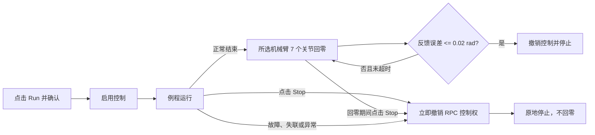
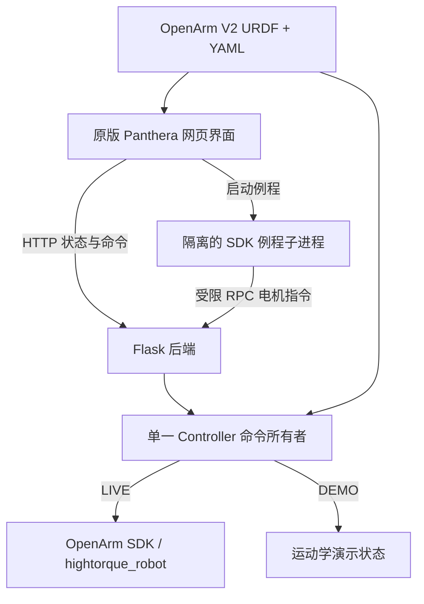

# OpenArm HT A1 Host

[中文](README.md) | [English](README_EN.md)

基于 Panthera-HT Host 原版界面适配的 OpenArm HT A1 双臂网页上位机。项目保持原有顶部工具栏、浮动面板、三维场景和操作布局，只替换机器人模型、状态协议与控制后端。


> 上图使用隔离的 Demo 服务拍摄。Demo 不连接串口，也不会控制真机。

## 功能一览

| 模块 | 当前能力 |
| --- | --- |
| 机器人 | 左／右各 7 关节，另含数值夹爪通道 |
| 三维模型 | 读取实际 OpenArm V2 URDF/STL，实时同步关节状态 |
| 控制模式 | Position、Gravity、Gra+Fri、Impedance |
| 轨迹 | 最多 6 个网页路点，带速度和加速度校验 |
| SDK 例程 | 13 个例程可从网页启动，其他例程可查看源码并标记为 `[需终端]` |
| 力显示 | 阻抗模式下根据关节力矩、URDF 重力和雅可比估算末端力／力矩 |
| 安全机制 | 控制确认、单一串口所有者、心跳、反馈超时、故障撤权与立即停止 |

## 快速启动

### 真机模式

```bash
cd /home/ht/01_传统控制/OpenarmHT-A1_Host
./backend.sh
```

打开 [http://localhost:5002](http://localhost:5002)。无参数启动默认为 LIVE，但服务启动本身不会连接硬件；只有在页面点击 **Connect** 并选择 `left`、`right` 或 `both` 后才初始化对应机械臂，而且连接阶段只读取状态。

### Demo 模式

```bash
cd /home/ht/01_传统控制/OpenarmHT-A1_Host
./start.sh
```

打开 [http://localhost:5001](http://localhost:5001)。Demo 不导入原生电机 SDK、不打开串口，适合查看界面和验证交互。

前后端分开调试时：

```bash
./backend.sh --demo
# 另一个终端
./frontend.sh
```

开发前端地址为 [http://localhost:3001](http://localhost:3001)。

## 界面导览

<table>
  <tr>
    <td width="50%"></td>
    <td width="50%"></td>
  </tr>
  <tr>
    <td align="center">关节、速度、单位与回零控制</td>
    <td align="center">例程选择、运行状态与输出日志</td>
  </tr>
</table>

### 连接和关节控制

1. 在 **Robot Connection** 中点击 **Connect**。
2. 真机模式选择左臂、右臂或双臂；连接成功后先检查关节反馈是否合理。
3. 在 **Joints** 面板设置速度和目标位置，再点击 **Send Position**。
4. **Reset** 使用原面板入口，将关节目标设为零位。

双臂连接时，Joints 面板显示 14 个关节和 `left_gripper`、`right_gripper` 两个夹爪通道。J2/J6 的符号映射和全部限位来自实际 YAML。

### 控制模式

- **Position**：位置速度控制。
- **Gravity**：重力补偿。
- **Gra+Fri**：重力和摩擦补偿。
- **Impedance**：关节阻抗控制；切换时以当前姿态作为目标，避免目标突跳。


连接双臂时，End Effector 面板显示左臂 J7 连杆原点；连接单臂时显示该臂。阻抗模式中的 `Estimated Force / Torque` 是基于电机力矩反馈的准静态估算，坐标系为 `base_link`，测量点为 J7 连杆原点。摩擦、加速度和模型误差会进入结果，因此它不能替代六维力传感器。Demo 不模拟外力，显示 `—` 属于正常现象。

### 路点轨迹

1. 移动到期望姿态后点击 **+ Add Current**。
2. 最多记录 6 个路点，包含双臂与夹爪位置。
3. 用 **Move to Point 1** 预览第一个路点，再用 **Run Trajectory** 执行。
4. 段时长不足、速度或加速度超限时，后端会拒绝运行。

## SDK 例程

网页当前支持以下 13 个例程：

| 类型 | 例程 |
| --- | --- |
| 状态读取 | `0_dual_openarm_HT_get_state.py` |
| 关节控制 | `1_dual_Joint_PD_control.py`、`1_dual_Joint_PosVel_control.py`、`1_dual_moveJ_control.py` |
| 运动学 | `1_dual_forward_kinematics_test.py`、`1_dual_inverse_kinematics_test.py` |
| 重力／阻抗 | `2_dual_gravity_compensation_control.py`、`2_dual_gravity_friction_compensation_control.py`、`2_dual_Jointimpendence_control_with_gra_pd.py`、`2_dual_Jointimpendence_control_with_gra_fri_pd.py`、`3_gravity_compensation_with_fk.py` |
| 轨迹 | `3_dual_sin_trajectory_control.py`、`3_sin_trajectory_control_with_plot.py` |

其他脚本仍会显示在列表中，选择后可以查看源码；`[需终端]` 表示尚未通过网页传输适配，**Run** 按钮会保持禁用。两个插值例程的原始默认峰值约为 `2.1875 / 2.3075 rad/s`，超过网页的 `1 rad/s` 限制，因此尚未开放。

### 正常结束与 Stop 的区别



- 例程**正常结束**后，所选机械臂的 7 个关节以 `0.25 rad/s` 回零；夹爪不额外回零。
- 点击 **Stop** 会立即停止并撤销控制，不执行回零动作。
- 回零过程中仍可点击 **Stop** 中断。
- 故障、页面心跳丢失或例程异常退出时只停止，不自动运动到零位。

## 系统结构



例程子进程不会再次打开串口。它使用受限 RPC 将经过限位、速度、力矩和模式检查的命令交给唯一的后端控制器，避免网页和例程争抢硬件连接。

## SDK 与项目结构

默认 SDK 位于同级目录：

```text
../OpenarmHT-A1_SDK（NEW）/
├── scripts/Lib/Openarm.py
├── robot_param/Openarm_left.yaml
├── robot_param/Openarm_right.yaml
└── OpenarmV2_URDF/
```

Host 目录：

```text
OpenarmHT-A1_Host/
├── backend/              # Flask、控制器、模型、例程 RPC
├── frontend/             # 保持原布局的 Three.js 网页
├── docs/images/          # README 截图
├── tests/                # 离线、接口和生命周期测试
├── backend.sh            # 无参数：LIVE，端口 5002
├── start.sh              # 构建并启动 Demo，端口 5001
└── README_EN.md          # English documentation
```

默认 Python 为 `~/miniconda3/envs/panthera/bin/python`。可用 `OPENARM_SDK_ROOT` 和 `OPENARM_PYTHON` 覆盖路径。`./install.sh` 只安装 Host 依赖，不会自动升级原生电机 SDK。

## 安全边界

- 网页心跳丢失超过 2 秒会撤销控制。
- 任一电机反馈时间戳超过 0.5 秒未更新、出现故障码或无效数据时会停止控制。
- 首次动作、模式切换和例程运行都有真机确认。
- 软件 Stop 不等同于物理急停；操作真机时必须确保急停可触及。
- 当前未集成自碰撞或环境碰撞检测。
- 固件电机超时配置未由本项目修改。
- 当前结论来自离线与 Demo 验证，尚未完成真机运动验证。

## 验证

```bash
cd /home/ht/01_传统控制/OpenarmHT-A1_Host
env -u LD_PRELOAD ~/miniconda3/envs/panthera/bin/python -m unittest discover -s tests -v
npm --prefix frontend run build
node tests/test_script_ui.mjs
node tests/test_transport_confirmation.mjs
```

当前 29 项 Python 离线测试覆盖：双臂接口、关节与夹爪限位、FK、力估算雅可比、反馈失效、脚本互斥、路点、正常结束回零、Stop 原地停止、失联与异常退出。两个前端测试覆盖例程错误显示以及真机确认和心跳顺序。

如需检查指定例程，可先启动隔离 Demo，再运行：

```bash
./backend.sh --demo --port 5003

# 另一个终端
env -u LD_PRELOAD ~/miniconda3/envs/panthera/bin/python \
  tests/smoke_demo.py --url http://127.0.0.1:5003 \
  --script 1_dual_Joint_PD_control.py
```

`smoke_demo.py` 检测到 LIVE 会拒绝执行。

## 常见问题

**修改后页面没有变化**  
停止原后端并重新运行 `./backend.sh`，然后在浏览器按 `Ctrl+Shift+R` 强制刷新。

**Connected 但例程不能运行**  
查看 Output 中的具体错误。当前实现会先完成真机确认，再启用控制，避免确认框暂停心跳导致控制被撤销。

**力和力矩显示为 `—`**  
Demo 模式不会生成假外力；真机需进入 Impedance 模式且关节反馈有效后才显示估算值。

**例程后面显示 `[需终端]`**  
该例程需要额外设备、终端交互，或其默认动作尚未通过网页安全限制校验。可以查看源码，但不能从网页运行。
