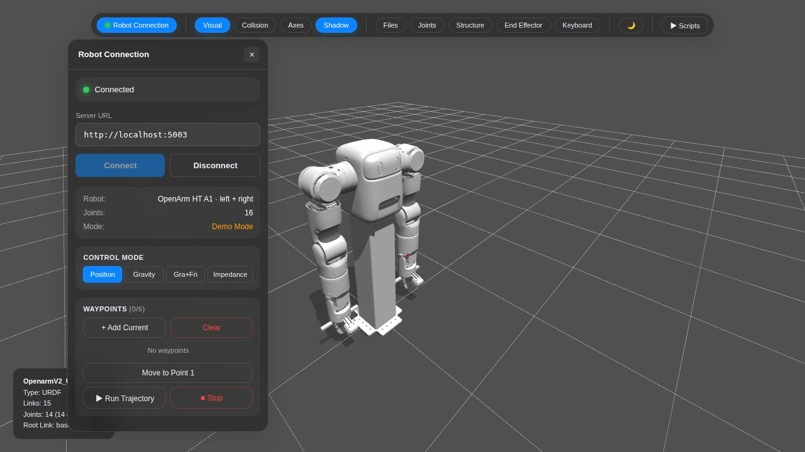
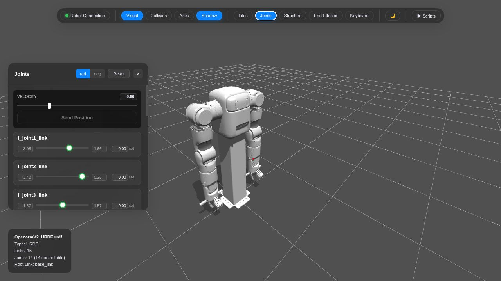
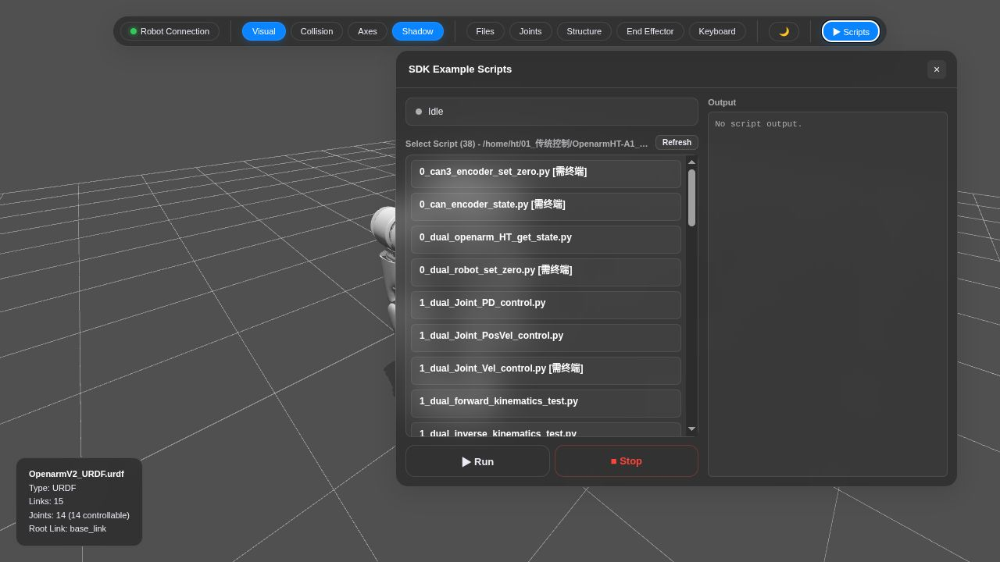
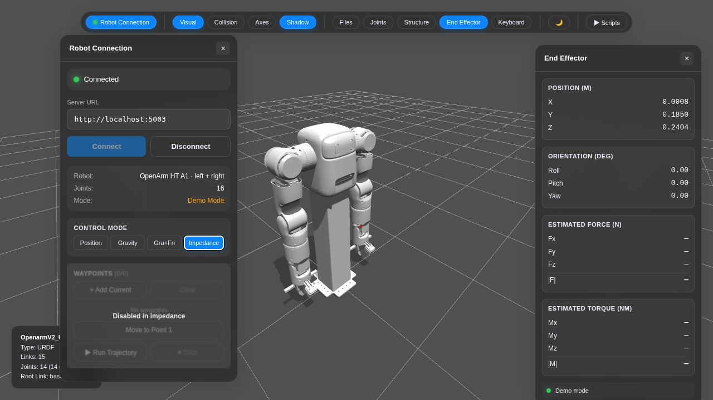
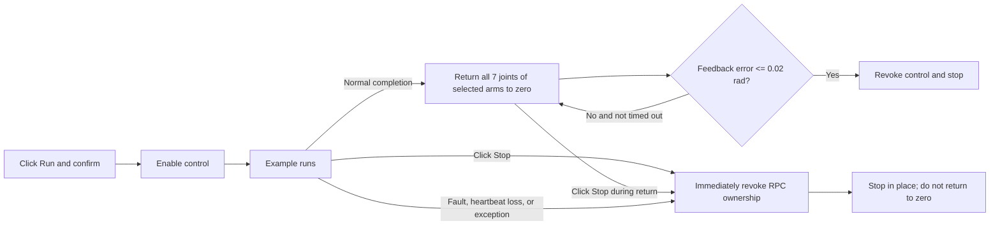
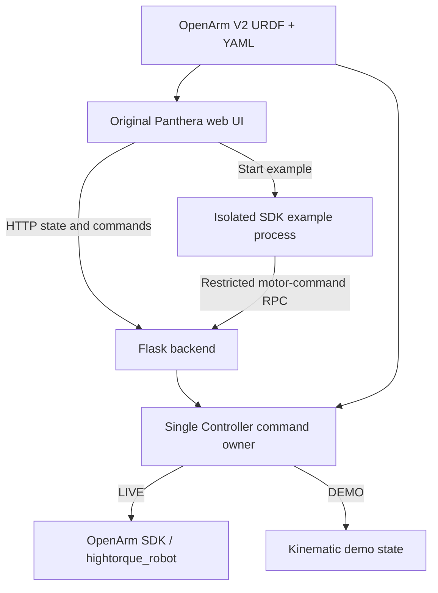

# OpenArm HT A1 Host

[中文](README.md) | [English](README_EN.md)

A web host for the OpenArm HT A1 dual-arm robot, adapted from the original Panthera-HT Host UI. The existing toolbar, floating panels, 3D scene, and panel layout are preserved; only the robot model, state protocol, and control backend are adapted for OpenArm.



> The screenshot above was captured with the isolated Demo service. Demo mode does not open a serial device or control real hardware.

## Features

| Area | Capability |
| --- | --- |
| Robot | Seven joints per arm plus one numeric gripper channel per side |
| 3D model | Loads the actual OpenArm V2 URDF/STL and follows joint feedback |
| Control modes | Position, Gravity, Gra+Fri, and Impedance |
| Trajectories | Up to six web waypoints with velocity and acceleration validation |
| SDK examples | 13 examples can run from the web UI; others remain available as source previews and are marked `[需终端]` (`Terminal required`) |
| Wrench display | Estimates end-effector force/torque from joint torque, URDF gravity, and the Jacobian in impedance mode |
| Safety controls | Explicit control confirmation, one serial owner, heartbeat, feedback timeout, fault revocation, and immediate Stop |

## Quick start

### Real-hardware mode

```bash
cd /home/ht/01_传统控制/OpenarmHT-A1_Host
./backend.sh
```

Open [http://localhost:5002](http://localhost:5002). Running `backend.sh` without arguments selects LIVE mode, but starting the service does not connect hardware. The corresponding arm is initialized only after you click **Connect** and choose `left`, `right`, or `both`; the connection step reads feedback only.

### Demo mode

```bash
cd /home/ht/01_传统控制/OpenarmHT-A1_Host
./start.sh
```

Open [http://localhost:5001](http://localhost:5001). Demo mode does not import the native motor SDK or open serial devices, so it is suitable for UI inspection and interaction tests.

For separate frontend/backend development:

```bash
./backend.sh --demo
+# In another terminal
+./frontend.sh
```

The development frontend is available at [http://localhost:3001](http://localhost:3001).

## UI tour

<table>
  <tr>
    <td width="50%"></td>
    <td width="50%"></td>
  </tr>
  <tr>
    <td align="center">Joint targets, speed, units, and reset</td>
    <td align="center">Example selection, run state, and captured output</td>
  </tr>
</table>

### Connection and joint control

1. Click **Connect** in the **Robot Connection** panel.
2. In LIVE mode, select the left arm, right arm, or both, then inspect the feedback before enabling control.
3. Set the speed and target values in **Joints**, then click **Send Position**.
4. **Reset** uses the original panel action to set joint targets to zero.

With both arms connected, the Joints panel shows 14 joints and the `left_gripper` and `right_gripper` channels. J2/J6 signs and all limits come from the current YAML files.

### Control modes

- **Position**: position/velocity control.
- **Gravity**: gravity compensation.
- **Gra+Fri**: gravity plus friction compensation.
- **Impedance**: joint impedance control; the current pose is captured as the target during mode changes to avoid a target jump.



When both arms are connected, the End Effector panel displays the left J7 link origin; with one arm connected, it displays that arm. `Estimated Force / Torque` is a quasi-static estimate derived from motor torque feedback. It is expressed in `base_link` at the J7 link origin. Friction, acceleration, and model errors affect the result, so it is not a substitute for a six-axis force/torque sensor. Demo mode deliberately shows `—` because it does not synthesize contact forces.

### Waypoint trajectories

1. Move to the desired pose and click **+ Add Current**.
2. Record up to six waypoints, including both arms and grippers.
3. Use **Move to Point 1** to preview the first point, then **Run Trajectory** to execute the sequence.
4. The backend rejects segments whose duration violates the configured velocity or acceleration limits.

## SDK examples

The following 13 examples are currently adapted for web execution:

| Category | Examples |
| --- | --- |
| State | `0_dual_openarm_HT_get_state.py` |
| Joint control | `1_dual_Joint_PD_control.py`, `1_dual_Joint_PosVel_control.py`, `1_dual_moveJ_control.py` |
| Kinematics | `1_dual_forward_kinematics_test.py`, `1_dual_inverse_kinematics_test.py` |
| Gravity / impedance | `2_dual_gravity_compensation_control.py`, `2_dual_gravity_friction_compensation_control.py`, `2_dual_Jointimpendence_control_with_gra_pd.py`, `2_dual_Jointimpendence_control_with_gra_fri_pd.py`, `3_gravity_compensation_with_fk.py` |
| Trajectories | `3_dual_sin_trajectory_control.py`, `3_sin_trajectory_control_with_plot.py` |

Other scripts remain visible and can be inspected as source. `[需终端]` (`Terminal required`) means the script has not been adapted to the restricted web transport, so **Run** stays disabled. The two interpolation examples have original peak speeds of approximately `2.1875 / 2.3075 rad/s`, above the web limit of `1 rad/s`, and therefore remain disabled.

### Normal completion versus Stop



- After **normal completion**, all seven joints of the selected arms return to zero at `0.25 rad/s`; no extra gripper-zero command is added.
- Clicking **Stop** immediately revokes control and does not issue a return-to-zero motion.
- **Stop** can also interrupt the automatic return-to-zero phase.
- Faults, heartbeat loss, and abnormal exits stop in place and never trigger automatic motion to zero.

## Architecture



Example processes never open a second serial connection. They send restricted motor commands through RPC to the single backend controller, which validates joint limits, speed, torque, and command mode before forwarding them.

## SDK and project layout

The default SDK is expected next to this project:

```text
../OpenarmHT-A1_SDK（NEW）/
├── scripts/Lib/Openarm.py
├── robot_param/Openarm_left.yaml
├── robot_param/Openarm_right.yaml
└── OpenarmV2_URDF/
```

Host layout:

```text
OpenarmHT-A1_Host/
├── backend/              # Flask, controller, model, and example RPC
├── frontend/             # Three.js UI with the original layout
├── docs/images/          # README screenshots
├── tests/                # Offline, API, and lifecycle tests
├── backend.sh            # No arguments: LIVE on port 5002
├── start.sh              # Build and start Demo on port 5001
└── README.md             # Chinese documentation
```

The default interpreter is `~/miniconda3/envs/panthera/bin/python`. Override paths with `OPENARM_SDK_ROOT` and `OPENARM_PYTHON`. `./install.sh` installs Host dependencies only and does not upgrade the native motor SDK.

## Safety boundaries

- Browser-heartbeat loss for more than two seconds revokes control.
- A feedback timestamp older than 0.5 seconds, a motor fault, or invalid numeric feedback stops control.
- The first motion, mode switch, and example execution require explicit LIVE confirmation.
- Software Stop is not a physical emergency stop; keep the physical e-stop within reach during hardware operation.
- Self-collision and environment-collision checks are not integrated.
- This project does not modify firmware motor-timeout settings.
- Current evidence is from offline and Demo validation; real-hardware motion has not been validated.

## Validation

```bash
cd /home/ht/01_传统控制/OpenarmHT-A1_Host
env -u LD_PRELOAD ~/miniconda3/envs/panthera/bin/python -m unittest discover -s tests -v
npm --prefix frontend run build
node tests/test_script_ui.mjs
node tests/test_transport_confirmation.mjs
```

The 29 Python offline tests cover the dual-arm API, joint/gripper limits, FK, wrench-estimation Jacobian, stale feedback, example ownership, waypoints, normal-completion homing, Stop-in-place behavior, heartbeat loss, and abnormal exits. Two frontend tests cover persistent example errors and the LIVE confirmation/heartbeat order.

To smoke-test one example against an isolated Demo service:

```bash
./backend.sh --demo --port 5003

# In another terminal
env -u LD_PRELOAD ~/miniconda3/envs/panthera/bin/python \
  tests/smoke_demo.py --url http://127.0.0.1:5003 \
  --script 1_dual_Joint_PD_control.py
```

`smoke_demo.py` refuses to run when it detects LIVE mode.

## Troubleshooting

**The page does not show recent changes**  
Stop the old backend, run `./backend.sh` again, and force-refresh the browser with `Ctrl+Shift+R`.

**Connected, but an example will not run**  
Read the specific error in Output. LIVE confirmation now completes before control is enabled, preventing the confirmation dialog from pausing the heartbeat and revoking control.

**Force and torque show `—`**  
Demo mode does not fabricate external forces. In LIVE mode, estimates appear only in Impedance mode with valid joint feedback.

**An example is marked `[需终端]` (`Terminal required`)**  
It depends on extra hardware or terminal interaction, or its default motion has not passed the web safety limits. Its source can be viewed, but it cannot run from the web UI.
