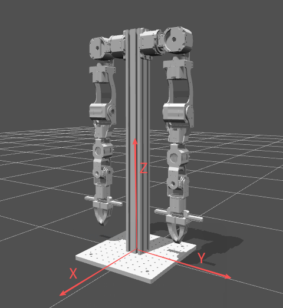
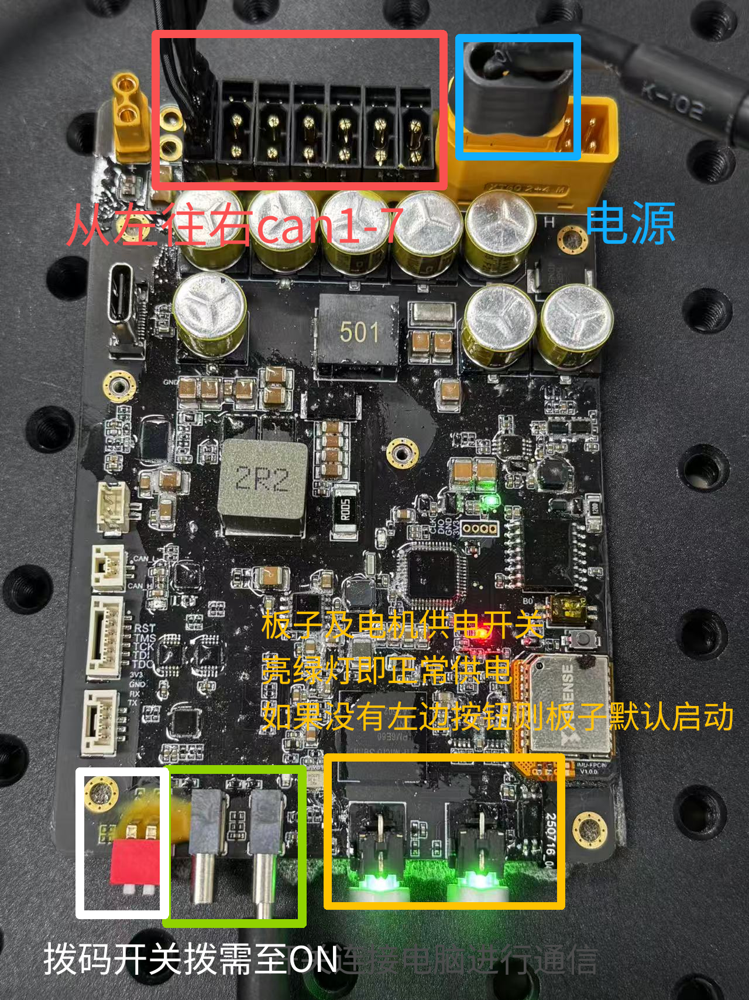

# openarm_HT Python SDK

[English](README_EN.md) | **简体中文**

`openarm_HT` 是面向 OpenArm-HT A1 双臂机器人的 Python SDK。左右臂各包含 7 个机械臂关节和 1 个独立夹爪电机。SDK 提供电机通信、关节/MIT 控制、Pinocchio 运动学与动力学、轨迹规划、QP 逆运动学、轨迹录制回放、SSH 终端键盘控制和 Quest VR 控制例程。

> [!CAUTION]
> 所有动作脚本都会连接真实电机。首次运行必须清空工作区、确认急停有效、有人看护，并随时准备按 `Ctrl+C`。当前电机配置中的固件位置超时/位置限制并未全部启用，Python/URDF 限位不能替代机械限位和急停。

## 项目全景

本仓库不是单一的脚本集合，而是一套从原生电机 SDK 到双臂应用的完整工程：

```text
OpenArm-HT A1 硬件 / HighTorque 通信板
        │
        ▼
HighTorque C++ SDK（外部原生依赖）
        │
        ▼
src/bindings.cpp + pybind11
        │
        ▼
hightorque_robot.Robot / Motor（预编译 wheel 或源码构建）
        │
        ▼
scripts/Lib/Openarm.py（7 轴高层控制、运动学、动力学、轨迹）
        │
        ├── 关节/MIT/阻抗/moveJ/moveL
        ├── Pinocchio FK/IK/Jacobian/动力学
        ├── OSQP 速度级 QP IK
        ├── JSONL 录制与回放
        ├── SSH 键盘控制
        └── Quest VR 控制
```

仓库还包含：

- 完整 OpenarmV2 双臂 URDF 和 STL 网格；
- x86_64/aarch64、Python 3.9–3.12 的预编译电机 SDK wheel；
- Quest WebXR → WebSocket → UDP 数据转发子项目；
- Intel RealSense D435i RGB+Depth Web 查看器；
- 离线 V2 模型回归工具和底层单电机示例。

## 仓库结构

```text
OpenarmHT-A1_SDK/
├── CMakeLists.txt                     # pybind11 原生扩展构建
├── setup.py / pyproject.toml          # Python 打包
├── requirements.txt                   # 高层 Python 依赖
├── motor_whl/                         # 预编译 hightorque_robot wheel
├── src/
│   └── bindings.cpp                   # C++ Robot/Motor Python 绑定
├── OpenarmV2_URDF/
│   ├── urdf/OpenarmV2_URDF.urdf       # 14 轴双臂模型
│   ├── meshes/                        # base + 左右 J1–J7 STL
│   ├── launch/                        # ROS/ROS 2 显示启动文件
│   └── config/                        # joint state 配置
├── robot_param/
│   ├── Openarm_left.yaml
│   ├── Openarm_right.yaml
│   └── motor_param/                   # 通信板、电机 ID/型号/串口配置
├── scripts/
│   ├── Lib/                           # Openarm、QP、记录器、TTY、镜像工具
│   ├── motor_example/                 # 底层单电机控制
│   ├── 0_* ... 8_*                    # 双臂应用例程
│   └── openarm_trajectory_test1.jsonl
├── Quest_controller_stream/
│   ├── index.html                     # Quest WebXR 页面
│   ├── quest_stream_ui.py             # PyQt5 桌面 UI
│   ├── quest_stream_tui.py            # 无 PyQt5 的终端 UI
│   ├── start_stream_server.py         # HTTP(S)+WS(S)→UDP 服务
│   └── udp_receiver_test.py
├── run_quest_stream_tui.sh            # Quest TUI 根目录启动器
├── tools/
│   ├── test_openarm_v2_model.py       # 纯离线模型回归
│   ├── d435i_web_viewer               # 已构建查看器
│   ├── d435i_web_viewer.cpp           # RealSense/OpenCV 源码
│   └── start_d435i_web_viewer.sh
├── images/                            # README 图片
├── README.md                          # 中文
└── README_EN.md                       # English
```

## 当前模型与镜像约定

<p align="center">
  
</p>

- 完整模型：`OpenarmV2_URDF/urdf/OpenarmV2_URDF.urdf`
- 模型自由度：左右各 7 轴，共 14 个 revolute joint
- 左 TCP：`l_joint7_link`
- 右 TCP：`r_joint7_link`
- 电机坐标到模型坐标：`joint_signs = [1, -1, 1, 1, 1, -1, 1]`
- 严格镜像关节目标：`q_right = -q_left`
- 右臂 J1/J4 使用左臂限位的反号镜像：
  - J1：`[-1.6581, 3.0543] rad`
  - J4：`[-1.0472, 2.2689] rad`
- OpenarmV2 URDF 不包含夹爪 collision 几何；夹爪电机仍由底层 SDK 独立控制。

当前左右镜像限位、7 个关节方向、FK、Jacobian twist、重力方向和 101 点启动轨迹已通过离线回归。实体电机方向仍应在首次真机运行时小步确认。

## 系统要求

- Ubuntu 20.04/22.04，x86_64 或 aarch64
- Python 3.9–3.12（推荐 Python 3.10）
- HighTorque 通信板与 OpenArm-HT A1 硬件
- `hightorque_robot` 对应架构/Python 版本 wheel
- PyYAML、Pinocchio（pip 包名 `pin`）、SciPy、OSQP
- 绘图例程额外需要 `matplotlib`
- Quest VR 例程需要 Quest 数据转发服务

## 安装

```bash
conda create -n panthera python=3.10
conda activate panthera
cd /home/nvidia/OpenarmHT-A1_SDK
```

安装与架构匹配的底层 wheel，例如 aarch64 + Python 3.10：

```bash
pip install motor_whl/hightorque_robot-1.0.0-cp310-cp310-linux_aarch64.whl
pip install -r requirements.txt
pip install matplotlib
```

验证环境：

```bash
python -c "import hightorque_robot; print('motor SDK OK')"
python -c "import pinocchio, scipy, yaml, osqp; print('robot dependencies OK')"
python -c "import matplotlib; print(matplotlib.__version__)"
```

### 预编译 wheel 与源码构建

推荐真机直接安装 `motor_whl/` 中的预编译 wheel。目录同时提供：

- x86_64：`hightorque_robot 1.2.0`，CPython 3.9/3.10/3.11/3.12；
- aarch64：`hightorque_robot 1.0.0`，CPython 3.9/3.10/3.11/3.12。

只有在已安装 HighTorque 原生 C++ SDK 及其 CMake package 时才需要源码构建。构建链依赖：

- CMake ≥ 3.12
- pybind11 ≥ 2.6
- HighTorque C++ SDK（`find_package(hightorque_robot)`）
- LCM
- yaml-cpp
- pthread / realtime library

Ubuntu 构建依赖示例：

```bash
sudo apt install cmake pkg-config liblcm-dev libyaml-cpp-dev
python -m pip install pybind11 setuptools wheel
python -m pip install .
```

`setup.py` 会调用 CMake 编译 `src/bindings.cpp`，生成 `_hightorque_robot` Python 扩展。源码构建不会自动下载厂商 C++ SDK。

### 包版本说明

- CMake/pyproject 元数据版本：`1.0.0`
- x86_64 预编译 wheel：`1.2.0`
- aarch64 预编译 wheel：`1.0.0`
- 运行时还会打印通信板、电机固件和 C++ SDK 版本；这些版本彼此独立。

## 连接与运行

<p align="center">
  
</p>

检查通信板：

```bash
ls /dev/ttyACM*
sudo chmod a+rw /dev/ttyACM*
```

进入脚本目录并直接运行例程：

```bash
cd /home/nvidia/OpenarmHT-A1_SDK/scripts
python 0_dual_openarm_HT_get_state.py
```

合并后的 `0_`、`1_`、`2_`、`3_`、`4_`、`6_` 和 `7_` 例程无需命令行参数，启动后选择：

```text
1. 左臂
2. 右臂
3. 双臂
```

双臂模式分别加载：

- `robot_param/Openarm_left.yaml`
- `robot_param/Openarm_right.yaml`

## 软件接口

### 底层 `hightorque_robot` 绑定

`src/bindings.cpp` 暴露的主要对象：

| 对象 | 主要能力 |
|---|---|
| `MotorState` | 时间、ID、模式、故障、位置、速度、力矩反馈 |
| `MotorVersion` | 电机固件版本 |
| `MotorParams` / `CANPortParams` / `CANBoardParams` / `RobotParams` | YAML 配置结构 |
| `Motor` | 位置、速度、力矩、电压、电流、PosVel、MIT、停止/刹车/复位 |
| `Robot` | 批量发送、状态/版本查询、设零、超时、LCM、FDCAN 复位、电机检索 |

底层示例位于 `scripts/motor_example/`。它们直接操作电机，绕过高层运动学与轨迹保护，必须先确认 ID、方向、零点和限制。

### 高层 `Openarm` API

```python
from Lib import Openarm

left = Openarm("../robot_param/Openarm_left.yaml")

q = left.get_current_pos()
dq = left.get_current_vel()
tau = left.get_current_torque()

left.Joint_Pos_Vel(q, [0.2] * left.motor_count, left.max_torque)
fk = left.forward_kinematics(q)
J = left.get_jacobian(q)
g = left.get_Gravity(q)

left.gripper_open()
left.set_stop()
```

高层能力包括：

- 关节位置-速度、速度、moveJ 和 MIT 五参数控制；
- 夹爪位置/MIT、打开和闭合；
- FK、DLS IK、Jacobian、可操作度；
- 重力、摩擦、Coriolis、质量矩阵和完整动力学；
- 笛卡尔路径、时间参数化、样条平滑和 moveL；
- 七次插值；
- YAML/URDF 关节与 TCP 一致性检查。

## 当前脚本索引

### 0：状态与零位

| 文件 | 功能 |
|---|---|
| `0_dual_openarm_HT_get_state.py` | 左/右/双臂状态、速度、力矩和夹爪反馈 |
| `0_dual_robot_set_zero.py` | 左/右/双臂设零、保留已有零位、状态查看和回零测试 |

### 1：关节控制与 FK/IK

| 文件 | 功能 |
|---|---|
| `1_dual_forward_kinematics_test.py` | 实时 FK/TCP 位姿 |
| `1_dual_inverse_kinematics_test.py` | 当前姿态 FK→IK 一致性和实时关节/TCP 输出 |
| `1_dual_Joint_PD_control.py` | MIT/PD 关节控制 |
| `1_dual_Joint_PosVel_control.py` | 位置-速度动作与夹爪演示 |
| `1_dual_Joint_Vel_control.py` | J1 速度往复控制 |
| `1_dual_moveJ_control.py` | moveJ 目标、到位误差和回零 |

### 2：动力学补偿与阻抗

| 文件 | 功能 |
|---|---|
| `2_dual_gravity_compensation_control.py` | `0.8 × G(q)` 重力补偿 |
| `2_dual_gravity_friction_compensation_control.py` | `0.8 × G(q) + friction` |
| `2_dual_Jointimpendence_control_with_gra_pd.py` | 关节阻抗 + 重力前馈 |
| `2_dual_Jointimpendence_control_with_gra_fri_pd.py` | 关节阻抗 + 重力 + 摩擦前馈 |
| `2_dual_inv_PosVel_control.py` | FK 生成可达目标，再执行 IK→moveJ→回零 |

### 3：插值、正弦轨迹与绘图

| 文件 | 功能 |
|---|---|
| `3_interpolation_control_zeroVel.py` | 零中间速度七次插值 |
| `3_interpolation_control_nozeroVel.py` | 非零中间速度连续插值 |
| `3_dual_sin_trajectory_control.py` | 七关节正弦轨迹和夹爪同步 |
| `3_sin_trajectory_control_with_plot.py` | 轨迹控制、期望/实际曲线及 RMSE |
| `3_gravity_compensation_with_fk.py` | 重力补偿并实时输出 FK |

绘图文件自动保存在 `scripts/`：

- `sin_trajectory_tracking_left.png`
- `sin_trajectory_tracking_right.png`
- `sin_trajectory_tracking_dual.png`

### 4：QP 逆运动学

| 文件 | 功能 |
|---|---|
| `4_dual_QP_inverse_kinematics_control.py` | 左/右/双臂 MIT + 有界 QP 举臂、头顶画圆和回零 |

QP 使用各臂独立 `PinocchioOSQPIK`、J4 分支约束、实际反馈误差门限以及 YAML/URDF 限位。右臂镜像限位修正后，J1 举臂终点与左臂对称。

### 5：遥操与轨迹录制回放

| 文件 | 功能 |
|---|---|
| `5_teleop_control.py` | 旧 Leader/Follower 主从臂遥操 |
| `5_trajectory_record_replay.py` | 单/双臂 JSONL 轨迹录制、历史选择和 MIT 回放 |

```bash
python 5_trajectory_record_replay.py
```

### 6：笛卡尔 moveL

| 文件 | 功能 |
|---|---|
| `6_moveL_pos_control.py` | 镜像直线、对角线和正方形路径 |
| `6_moveL_rotate_control.py` | 镜像 X/Y/Z 姿态和圆锥运动 |

双臂模式按同一阶段依次执行两侧阻塞式 `moveL`，避免并行线程破坏每臂 MIT 时序。位置示例使用经过当前 V2 模型完整规划的幅度。

### 7：SSH 终端键盘控制

| 文件 | 功能 |
|---|---|
| `7_keyboard_cartesian_pos_control.py` | 增量位置/姿态 IK 控制 |
| `7_keyboard_cartesian_vel_control.py` | Jacobian/DLS 速度控制 |
| `7_keyboard_cartesian_vel_collision_control.py` | 速度控制 + 精确 URDF/FCL 预测碰撞检查 |
| `7_keyboard_cartesian_impedance_control.py` | 笛卡尔阻抗与重力前馈 |
| `7_keyboard_cartesian_pd_nullspace_lock_control.py` | DLS + 零空间姿态锁定 + 关节 PD |

五个脚本都使用标准库 TTY 监听，不依赖 `pynput` 或 X 桌面，可直接在 SSH 终端运行。按住键时依赖终端按键重复，停止重复约 `0.18 s` 后会自动模拟松键。

键位：

| 键 | 动作 |
|---|---|
| `W / S` | X 正/负 |
| `A / D` | Y 正/负；双臂模式中右臂自动镜像 |
| `Q / E` | Z 上/下 |
| `1 / 2` | 绕 X 正/负；右臂镜像 |
| `3 / 4` | 绕 Y 正/负 |
| `5 / 6` | 绕 Z 正/负；右臂镜像 |
| `R` | 重新锁定当前臂角，仅 nullspace-lock 脚本 |
| `Esc` | 退出 |
| `Ctrl+C` | 强制中断 |

共用启动姿态采用 VR 镜像姿态：

```text
左臂 [ 0.3, 0, 0, -1.87, 0, 0, 0]
右臂 [-0.3, 0, 0, +1.87, 0, 0, 0]
```

碰撞版本：

- 双臂检查 91 对非相邻真实 collision 几何，包含左右臂交叉碰撞；
- 单臂各检查 21 对；
- 预测未来 `0.20 s`，共 8 个中间采样点；
- 预测碰撞或关节越限时停止所选机械臂；
- 首次加载 collision 网格约需十余秒；
- OpenarmV2 没有夹爪 collision 几何，且真实制动距离尚未标定，因此仍需低速看护。

### 8：Quest VR

- `8_vr_single_cartesian_dls_control.py`
- `8_vr_single_cartesian_qp_control.py`
- `8_vr_dual_cartesian_dls_control.py`
- `8_vr_dual_cartesian_qp_control.py`

本仓库已内置 `Quest_controller_stream/`，通过 Quest Browser 中的 WebXR 页面读取左右手柄位姿、摇杆、Trigger、Squeeze 和按钮，并经 WebSocket 转发到机器人端 UDP，默认端口 `5005`。

推荐使用无 PyQt5 依赖的终端 UI：

```bash
cd /home/nvidia/OpenarmHT-A1_SDK
./run_quest_stream_tui.sh
```

TUI 支持 USB/WiFi、HTTP(S)、WS(S)、UDP 目标、服务启停、数据验证和左右手实时页面。WiFi 模式使用 OpenSSL 自签名证书；USB 模式额外需要 `adb`。底层 stream 服务需要：

```bash
pip install websockets
```

桌面 UI 还需要：

```bash
pip install PyQt5
python Quest_controller_stream/quest_stream_ui.py
```

启动机器人端控制前，先停止 TUI/UI 的 UDP Verify，避免与机器人脚本同时占用 `5005`：

```bash
cd scripts
python 8_vr_dual_cartesian_qp_control.py
```

## 配置与开发入口

- 高层控制类：`scripts/Lib/Openarm.py`
- QP IK：`scripts/Lib/qp_ik.py`
- 轨迹记录器：`scripts/Lib/recorder.py`
- SSH 键盘：`scripts/Lib/terminal_keyboard.py`
- 双臂选择与镜像：`scripts/Lib/keyboard_arm_utils.py`
- 左右臂配置：`robot_param/Openarm_left.yaml`、`robot_param/Openarm_right.yaml`

### 配置层级

```text
Openarm_left/right.yaml
├── motor_param 配置路径
├── 关节/夹爪/速度/加速度/力矩限制
├── URDF、base 和 TCP frame
├── 关节名与 joint_signs
└── moveL 采样参数
        │
        ▼
robot_param/motor_param/7dof_*.yaml
├── 串口类型与波特率
├── CANboard / CANport / serial_id
├── 电机 ID、型号和名称
├── 固件位置/力矩限制开关
└── 超时、刹车和通信选项
```

修改 URDF 或 YAML 后必须重新运行左右 FK、限位、镜像和碰撞离线检查。不要只因文件能解析就认为电机传动和物理方向正确。

### 测试与离线验证

V2 模型回归：

```bash
conda activate panthera
python tools/test_openarm_v2_model.py
```

该测试不创建底层 `Robot`，不会打开串口；它验证 14-DoF 模型、左右镜像 FK、Jacobian、重力、Coriolis、质量矩阵和动力学形状。硬件到位误差、延迟、制动、力矩和真实碰撞仍需单独验收。

### D435i Web 查看器

`tools/d435i_web_viewer` 使用 librealsense2 和 OpenCV 采集 `640×360 @ 30 FPS` RGB/Depth，将左右拼接 JPEG 作为 MJPEG 发布到本机 HTTP 服务。

```bash
./tools/start_d435i_web_viewer.sh
```

默认监听 `127.0.0.1:8765`。通过 VS Code 端口转发打开：

```text
http://127.0.0.1:8765
```

日志：`/home/nvidia/d435i_web_viewer.log`；PID：`/tmp/d435i_web_viewer.pid`。重新编译需要 librealsense2、OpenCV 和支持 C++ 的编译器。

### 开发与发布

- `setup.py` 和 `pyproject.toml` 描述原生扩展包；
- `CMakeLists.txt` 负责查找 Python、pybind11、HighTorque SDK、LCM 和 yaml-cpp；
- `src/bindings.cpp` 是底层 Python ABI 的唯一源码入口；
- `requirements.txt` 是 `scripts/Lib` 的高层依赖，不包含厂商 wheel；
- 不要提交 `__pycache__`、构建目录、临时轨迹、运行日志或设备证书私钥；
- 发布前应在目标架构/Python 版本上安装 wheel，并完成导入、离线模型和受监督硬件测试。

## 常见问题

### `ModuleNotFoundError: matplotlib`

```bash
conda activate panthera
python -m pip install matplotlib
```

### 键盘无响应

必须在真实交互式 TTY 中运行。不要通过不支持单字符输入的重定向或后台任务启动。无需安装 `pynput`。

### `Mesh ../meshes/*.STL could not be found`

碰撞脚本会临时以 URDF 目录作为相对网格路径基准。确认 `OpenarmV2_URDF/meshes/` 文件完整。

### `/dev/ttyACM*` 不存在

检查通信板供电、USB 线、急停、固件状态和串口占用，再检查权限。

## License

项目使用 MIT License，详见根目录 `LICENSE`。
